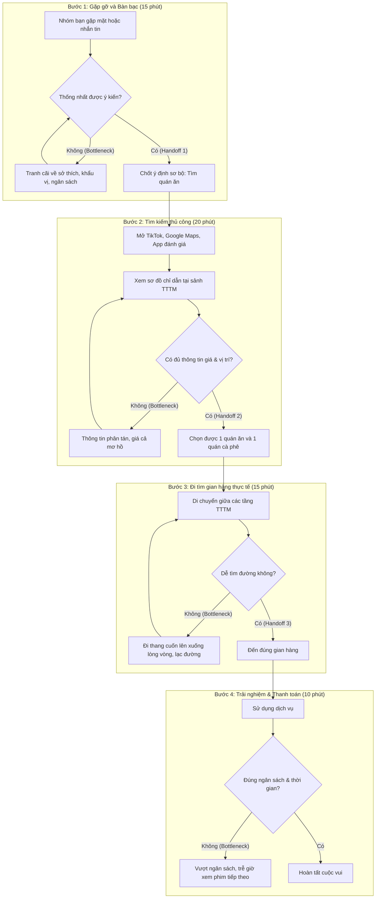

# Sơ đồ quy trình vận hành hiện tại (Current-State Workflow Diagram)

Dự án: **Vincom Smart Concierge — Trợ lý AI lập lộ trình trải nghiệm TTTM cá nhân hóa**
Công ty thành viên: **Vincom Retail**

---

## 1. Hình ảnh sơ đồ quy trình trực quan

File sơ đồ đồ họa được đính kèm trực tiếp tại: [04-workflow-diagram.png](04-workflow-diagram.png)

```text
┌─────────────────────────────────────────────────────────────────────────────┐
│              CURRENT-STATE WORKFLOW: TRẢI NGHIỆM TTTM VINCOM                │
├─────────────────┬─────────────────┬─────────────────┬───────────────────────┤
│     BƯỚC 1      │     BƯỚC 2      │     BƯỚC 3      │        BƯỚC 4         │
│ Gặp gỡ & Bàn bạc│ Tìm kiếm thông  │ Di chuyển tìm   │ Trải nghiệm & Trả tiền│
│                 │ tin thủ công    │ gian hàng       │                       │
│ Ai: Nhóm bạn    │ Ai: Nhóm bạn    │ Ai: Nhóm bạn    │ Ai: Nhóm bạn          │
│ ⏱ 15 phút 🔴     │ ⏱ 20 phút 🔴     │ ⏱ 15 phút 🔴     │ ⏱ 10 phút             │
│ In: Ý kiến rời  │ In: Ý định sơ bộ│ In: Vị trí sảnh,│ In: Hóa đơn, voucher  │
│     rạc, gu ăn  │     & review MXH│     biển chỉ dẫn│                       │
│ Out: Ý định     │ Out: DS quán ăn │ Out: Gian hàng  │ Out: Kết thúc buổi đi │
│      chung sơ bộ│      & giờ phim │      thực tế    │      chơi, phát sinh  │
├─────────────────┼─────────────────┼─────────────────┼───────────────────────┤
│ [BOTTLENECK]    │ [BOTTLENECK]    │ [BOTTLENECK]    │                       │
│ Bất đồng quan   │ Thông tin phân  │ Đi thang cuốn   │                       │
│ điểm, khác gu ăn│ tán, menu thiếu │ lộn xộn, mệt mỏi│                       │
│ và tiền nong    │ giá, mơ hồ quán │ trễ giờ phim    │                       │
├─────────────────┼─────────────────┼─────────────────┼───────────────────────┤
│ [HANDOFF]       │ [HANDOFF]       │ [HANDOFF]       │ [HANDOFF]             │
│ Ý kiến cá nhân  │ Thông tin mạng  │ Sơ đồ sảnh ->   │ Hoàn tất cuộc vui     │
│ -> Ý định chung │ -> DS quán ăn   │ Gian hàng thật  │                       │
└─────────────────┴─────────────────┴─────────────────┴───────────────────────┘
🔴 = Bottlenecks (Điểm nghẽn gây lãng phí thời gian)
⏱ Tổng thời gian lên kế hoạch & tìm đường thủ công (3 bước đầu): 50 phút (dao động 45 - 60 phút).
```

---

## 2. Sơ đồ luồng công việc chi tiết (Mermaid Flowchart)



---

## 3. Phân tích chi tiết các điểm nút

### A. Điểm nghẽn cổ chai (Bottlenecks)
1. **Bottleneck 1 (Bàn bạc):** Trung bình 3-4 người mất 15 phút để thỏa hiệp về gu ẩm thực và mức chi tiêu của mỗi người.
2. **Bottleneck 2 (Tìm kiếm):** Menu và bảng giá không được tổng hợp trên một màn hình, thông tin voucher bị phân tán khắp các trang mạng xã hội.
3. **Bottleneck 3 (Đi lại):** Các TTTM Vincom thường có quy mô lớn (4-5 tầng), nếu không có lộ trình tối ưu theo chiều thang máy, khách hàng phải đi bộ nhiều vòng gây mệt mỏi.
4. **Bottleneck 4 (Bội chi):** Do không tính tổng tiền trước, hóa đơn cuối cùng thường vượt từ 20% đến 40% so với dự tính ban đầu của sinh viên/giới trẻ.

### B. Điểm chuyển giao (Handoffs)
* **Handoff 1:** Chuyển từ nhu cầu mơ hồ của từng cá nhân sang ý định tập thể.
* **Handoff 2:** Chuyển từ kết quả tìm kiếm trên mạng sang quyết định chọn địa điểm cụ thể.
* **Handoff 3:** Chuyển từ sơ đồ số sang di chuyển thực tế trong không gian TTTM.

---

## 4. Căn cứ khoa học xác lập mốc thời gian Baseline (45 - 60 phút)

| Khâu trong quy trình | Thời gian tiêu tốn | Căn cứ / Nghiên cứu thực tế |
|---|:---:|---|
| **1. Bàn bạc, bất đồng ý kiến** | **15 phút** | Khảo sát **Food Indecision** của OnePoll (tranh luận chọn món theo nhóm kéo dài 15-20p). |
| **2. Tìm quán, đọc menu, so giá** | **20 phút** | Nghiên cứu **The Paradox of Choice** (Barry Schwartz) & Khảo sát hành vi F&B của Q&Me. |
| **3. Đi thang cuốn tìm gian hàng** | **15 phút** | Nghiên cứu **Indoor Wayfinding** tại Mega Mall của Hiệp hội TTTM Quốc tế (ICSC). |
| **Tổng thời gian lãng phí** | **50 phút** *(45 - 60p)* | **Tổng hợp từ 3 nghiên cứu hành vi thực tế nêu trên.** |

---

## 5. Kết luận đánh giá

* **Tổng thời gian lãng phí:** 45 - 60 phút cho mỗi lần đến Vincom.
* **Cơ hội cho AI:** Giải quyết triệt để cả 3 khâu đầu tiên chỉ trong **dưới 2 phút** bằng cách dùng LLM phân tích yêu cầu tự nhiên, tự động lọc cơ sở dữ liệu gian hàng theo tầng và xuất ra timeline tối ưu, không bị đảo tầng và không vượt ngân sách.
