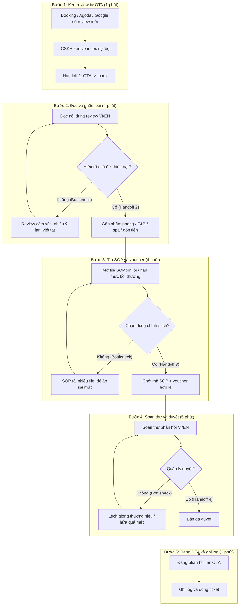

# Sơ đồ quy trình vận hành hiện tại (Current-State Workflow Diagram)

Dự án: **Vinpearl Guest Review Copilot — Trợ lý AI soạn bản nháp phản hồi đánh giá khách sạn trên OTA**
Công ty thành viên: **Vinpearl**

---

## 1. Hình ảnh sơ đồ quy trình trực quan

File sơ đồ đồ họa được đính kèm trực tiếp tại: [04-workflow-diagram.png](04-workflow-diagram.png) / [04-workflow-diagram.jpg](04-workflow-diagram.jpg)

```text
┌──────────────────────────────────────────────────────────────────────────────────────┐
│        CURRENT-STATE WORKFLOW: PHẢN HỒI ĐÁNH GIÁ OTA TẠI VINPEARL                    │
├──────────────┬──────────────┬──────────────┬──────────────┬──────────────────────────┤
│   BƯỚC 1     │   BƯỚC 2     │   BƯỚC 3     │   BƯỚC 4     │         BƯỚC 5           │
│ Kéo review   │ Đọc & phân   │ Tra SOP /    │ Soạn thư     │ Đăng OTA & ghi log       │
│ từ OTA       │ loại khiếu   │ voucher      │ VI/EN + duyệt│                          │
│              │ nại          │              │              │                          │
│ Ai: CSKH     │ Ai: CSKH     │ Ai: CSKH     │ Ai: CSKH +   │ Ai: CSKH                 │
│              │              │              │ Quản lý      │                          │
│ ⏱ 1 phút     │ ⏱ 4 phút 🔴  │ ⏱ 4 phút 🔴  │ ⏱ 5 phút 🔴  │ ⏱ 1 phút                 │
│ In: Booking/ │ In: Nội dung │ In: Chủ đề & │ In: SOP,     │ In: Bản đã duyệt         │
│ Agoda/Google │ review VI/EN │ mức độ       │ giọng brand  │ Out: Review đã trả lời   │
│ Out: Inbox   │ Out: Nhãn    │ Out: Mã SOP, │ Out: Bản nháp│                          │
│ chưa trả lời │ chủ đề       │ hạn mức      │ chờ duyệt    │                          │
├──────────────┼──────────────┼──────────────┼──────────────┼──────────────────────────┤
│              │ [BOTTLENECK] │ [BOTTLENECK] │ [BOTTLENECK] │                          │
│              │ Review cảm   │ SOP rải file,│ Lệch giọng   │                          │
│              │ xúc, nhiều ý │ dễ áp sai mức│ ca trực; chờ │                          │
│              │ lẫn lộn      │ bồi thường   │ duyệt lâu    │                          │
├──────────────┼──────────────┼──────────────┼──────────────┼──────────────────────────┤
│ [HANDOFF]    │ [HANDOFF]    │ [HANDOFF]    │ [HANDOFF]    │ [HANDOFF]                │
│ OTA -> Inbox │ Nội dung thô │ Chính sách   │ Bản nháp ->  │ Đóng ticket              │
│ nội bộ       │ -> Nhãn chủ  │ -> Khung trả │ Duyệt HITL   │                          │
│              │ đề           │ lời          │              │                          │
└──────────────┴──────────────┴──────────────┴──────────────┴──────────────────────────┘
🔴 = Bottlenecks (Điểm nghẽn gây lãng phí thời gian)
⏱ Tổng thời gian xử lý thủ công mỗi review: 15 phút (dao động 12–15 phút).
```

---

## 2. Sơ đồ luồng công việc chi tiết (Mermaid Flowchart)



---

## 3. Phân tích chi tiết các điểm nút

### A. Điểm nghẽn cổ chai (Bottlenecks)
1. **Bottleneck 1 (Đọc & phân loại):** Review 1–3 sao thường chứa nhiều khiếu nại cảm xúc trong một đoạn; CSKH mất khoảng 4 phút để gắn đúng chủ đề.
2. **Bottleneck 2 (Tra SOP):** Chính sách xin lỗi/voucher nằm rải file; áp sai hạn mức dễ dẫn đến hứa bồi thường ngoài quy định.
3. **Bottleneck 3 (Soạn & duyệt):** Mỗi ca trực viết giọng khác nhau; quản lý phải sửa lại trước khi đăng, làm trễ SLA 24 giờ.

### B. Điểm chuyển giao (Handoffs)
* **Handoff 1:** Từ kênh OTA công khai sang inbox nội bộ của property.
* **Handoff 2:** Từ nội dung review thô sang nhãn chủ đề vận hành.
* **Handoff 3:** Từ nhãn chủ đề sang khung chính sách SOP/voucher.
* **Handoff 4:** Từ bản nháp sang bước duyệt HITL trước khi đăng công khai.

---

## 4. Căn cứ xác lập mốc thời gian Baseline (12–15 phút)

| Khâu trong quy trình | Thời gian tiêu tốn | Căn cứ / Nghiên cứu thực tế |
|---|:---:|---|
| **1. Kéo review về inbox** | **1 phút** | Thao tác vận hành inbox đa kênh Booking/Agoda/Google. |
| **2. Đọc & phân loại khiếu nại** | **4 phút** | ReviewPro / Revinate: đọc và gắn nhãn review tiêu cực mất vài phút/lượt. |
| **3. Tra SOP / voucher** | **4 phút** | Thực tế CSKH khách sạn: chính sách bồi thường phân tán, dễ tra sai mức. |
| **4. Soạn thư + duyệt** | **5 phút** | Cornell CHR: phản hồi chất lượng trên OTA cần kiểm soát giọng thương hiệu. |
| **5. Đăng & ghi log** | **1 phút** | Thao tác đăng và đóng ticket. |
| **Tổng thời gian lãng phí** | **15 phút** *(12–15p)* | **Tổng hợp từ vận hành CSKH + nghiên cứu hospitality nêu trên.** |

---

## 5. Kết luận đánh giá

* **Tổng thời gian lãng phí:** 12–15 phút cho mỗi review 1–3 sao; ca cuối tuần ~40 review/người ≈ 10 giờ làm việc.
* **Cơ hội cho AI:** Rút 3 khâu đọc–tra SOP–soạn nháp xuống **dưới 3 phút** bằng LLM Feature + catalog SOP, bắt buộc `[DRAFT_ONLY]` và HITL trước khi đăng OTA; case pháp lý/an toàn phải escalate Guest Experience.
