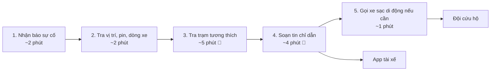

# Sơ đồ quy trình vận hành hiện tại — Xanh SM

Dự án: **Co-pilot soạn nháp xử lý xe taxi điện sắp hết pin**

Công ty thành viên: **Xanh SM (GSM)**

Sơ đồ đồ họa: [04-workflow-diagram.png](04-workflow-diagram.png)

## Quy trình hiện tại

| Bước | Người thực hiện | Công việc và đầu ra | Thời gian giả định | Handoff |
|---|---|---|---:|---|
| 1. Nhận báo sự cố | Điều phối viên | Nhận cuộc gọi/tin nhắn; ghi biển số và mô tả | ~2 phút | Tài xế -> ghi chú sự cố |
| 2. Xác định xe | Điều phối viên | Tra vị trí, phần trăm pin và dòng xe | ~2 phút | Biển số -> dữ liệu định vị |
| 3. Tra trạm phù hợp 🔴 | Điều phối viên | Đối chiếu khoảng cách, tình trạng trụ và cổng sạc | ~5 phút | Dashboard trạm -> quyết định điều phối |
| 4. Soạn tin chỉ dẫn 🔴 | Điều phối viên | Viết tin nhắn hướng dẫn và gửi qua app tài xế | ~4 phút | Điều phối viên -> app tài xế |
| 5. Gọi cứu hộ nếu cần | Điều phối viên | Liên hệ đội xe sạc di động khi pin quá thấp | ~1 phút | Điều phối viên -> đội cứu hộ |
| **Tổng** | | | **~14 phút/lượt (ước tính 12-15 phút)** | |

### Bottleneck và handoff

- **Bottleneck chính:** bước 3 và 4, tổng khoảng **9/14 phút** theo ước tính; điều phối viên tra cứu thủ công trạm và viết từng tin nhắn.
- **Handoff:** lời báo của tài xế thành ghi chú; biển số được dùng để tra dữ liệu định vị; kết quả dashboard thành quyết định của điều phối viên; tin được duyệt mới gửi qua app; yêu cầu cứu hộ được chuyển cho đội phụ trách.
- **Baseline:** mọi thời lượng trong sơ đồ là giả định, chưa đo từ log vận hành thật. Cần đo lại trước pilot.

### Cơ hội hỗ trợ bằng AI

Rule lọc trạm theo dữ liệu và ngưỡng an toàn; LLM chỉ soạn **bản nháp**. Điều phối viên phải kiểm tra, xác nhận và gửi. Với pin dưới 5%, hệ thống đề xuất nhánh xe sạc di động nhưng không được thể hiện như xe đã được điều động trước khi có người duyệt. Nếu thiếu dữ liệu, API lỗi hoặc đầu ra không hợp lệ, điều phối viên tiếp tục quy trình thủ công.
